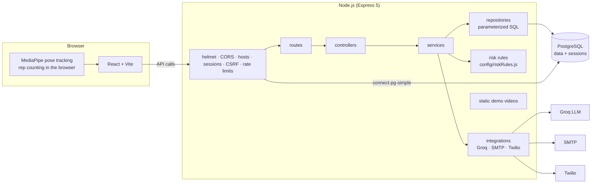

# Nexivo — Backend


The REST API behind **Nexivo**, a post-operative recovery monitoring system I built as a personal project. Every check-in is kept as permanent history and scored against the patient's own baseline, with trend alerts, explanations and a research module that measures this against fixed thresholds. Patients can also chat with an AI assistant that knows their doctor's notes (in English or Hindi) and do camera-tracked exercises; the doctor is alerted automatically when a patient's message sounds serious.

> **About this project.** Nexivo is a student project, built and maintained by me, [Tushar Singla](#author), a final-year B.Tech IT student. It isn't a commercial product, and it isn't meant for real patients or real medical data.

## Highlights

- **Personalized recovery scoring as pure functions.** `src/engine/` (no database or HTTP imports, enforced by a test) turns a patient's check-in history into a 0–100 score, trend and anomaly alerts, a category, the contribution of each parameter and template-based explanations. Every weight and threshold comes from a versioned scoring config, and every stored score records its config version. The same engine runs in the live API and in the research replay (`src/research/`).
- **Rewritten from Django to Node.js without changing behaviour** (doctor login, added later, is the one deliberate exception). The first version of the backend was Django. I rewrote it in Node.js + Express + PostgreSQL and kept every URL, JSON response, cookie and rule the React app depends on. A parity suite sends the same 116 request scenarios to both backends and compares status codes, headers, cookies, bodies, sessions and stored rows.
- **Raw SQL, no ORM.** Every query is a parameterized `pg` query in a repository module; the schema is plain SQL migrations with a small checksum-verifying runner.
- **Rule-based seriousness checks for the AI chat.** The model's reply is parsed, its seriousness score clamped and checked against configurable thresholds (`src/config/riskRules.js`, validated at startup). Above 0.75 the doctor gets an email and, optionally, a phone call (Twilio).
- **Security basics done properly:** sessions stored in Postgres, CSRF protection, exact-origin CORS, security headers, rate limits on login and chat, input validation, and logs that never contain names, emails or chat text.
- **Tested:** 1,061 unit and integration tests (95% line coverage), plus golden tests that check the tricky parts (Python-style JSON parsing, number formatting, the prompt and alert text) against outputs generated by the original Python code.

## Try it: demo accounts

Log in on the patient login page with one of these accounts, or on the doctor login page with the doctor account below. They hold made-up data only:

| Name                    | Email (login)                   | Password   | Medical notes (made up)              |
| ----------------------- | ------------------------------- | ---------- | ------------------------------------ |
| Demo Patient (Knee)     | `demo.knee@revivecare.test`     | `demo1234` | knee ACL reconstruction, 10 days ago |
| Demo Patient (Hip)      | `demo.hip@revivecare.test`      | `demo1234` | hip replacement, 3 weeks ago         |
| Demo Patient (Shoulder) | `demo.shoulder@revivecare.test` | `demo1234` | rotator cuff repair, 6 weeks ago     |
| Demo Patient (Appendix) | `demo.appendix@revivecare.test` | `demo1234` | appendectomy, 4 days ago             |

Doctor login: `demo.doctor@revivecare.test`, password `demo1234`. Please use made-up details if you add a patient.

Patient login is **email only** in this version: the password field has to be filled in, but its value isn't checked. Doctor passwords are checked. To create or reset these accounts on a database, run `npm run db:demo`. In production the demo doctor is only created when `DEMO_DOCTOR_PASSWORD` is set, because the default password is public. It also gives each one a recovery history (surgery profile, milestones, check-ins) ending in a different category: Knee → Requires attention, Hip → Slower than expected, Shoulder → Normal, Appendix → limited history. A patient who already has check-ins is left alone.

## Tech stack

| Area                  | Choice                                                                                       |
| --------------------- | -------------------------------------------------------------------------------------------- |
| Runtime and framework | Node.js 22, Express 5, ES modules                                                            |
| Database              | PostgreSQL 14 with `pg` (no ORM), SQL migrations                                             |
| Sessions and security | `express-session` + `connect-pg-simple`, `csrf-csrf`, `helmet`, `cors`, `express-rate-limit` |
| Validation and config | `zod`                                                                                        |
| AI and alerts         | `groq-sdk` (Llama 3.3 70B), `nodemailer`, Twilio REST API                                    |
| Logging               | `pino`, `pino-http`                                                                          |
| Testing and tooling   | Vitest, Supertest, ESLint, Prettier                                                          |

## Architecture



Every request follows the same path: route → guards (session, CSRF, validation) → controller (HTTP only) → service (business rules, no SQL) → repository (SQL only).

## Getting started

**Requirements:** Node.js 22+, PostgreSQL 14+.

### 1. Database

macOS (Homebrew):

```sh
brew install postgresql@14
brew services start postgresql@14
createuser revivecare
createdb -O revivecare revivecare_dev
createdb -O revivecare revivecare_test
createdb -O revivecare revivecare_parity
# The migration runner, the tests and the parity suite drop and recreate the
# `public` schema, so the app role must own it (PostgreSQL 14 gives it to the superuser).
for db in revivecare_dev revivecare_test revivecare_parity; do
  psql -d "$db" -c 'ALTER SCHEMA public OWNER TO revivecare'
done
```

`revivecare_test` is rebuilt by the test suite and `revivecare_parity` by the parity suite and the benchmark.

### 2. Environment

```sh
cp .env.example .env
```

Required: `DATABASE_URL` (e.g. `postgres://revivecare@localhost:5432/revivecare_dev`), `SESSION_SECRET` and `CSRF_SECRET` (32+ random characters each, e.g. `openssl rand -hex 32`). The chat needs `GROQ_API_KEY`; doctor alerts use the `SMTP_*`, `EMAIL_*`, `DOCTOR_EMAIL` and optional `TWILIO_*` values. Every variable is described in `.env.example`, and the server refuses to start, naming the problem, if one is missing or invalid.

### 3. Install, migrate, add data

```sh
npm install
npm run db:migrate
npm run db:demo     # the demo accounts above, with recovery histories
npm run db:seed     # optional: 1,200 generated patients for local testing (needs SEED_USER_PASSWORD)
```

### 4. Run

```sh
npm run dev         # http://localhost:3000, restarts on changes
curl http://localhost:3000/api/health   # → {"status":"ok","db":"ok"}
```

Then start the frontend (`npm run dev` in `../Nexivo_Frontend`) and open http://localhost:5173. Its dev server forwards API calls to port 3000.

## Testing

```sh
npm test                # unit + integration tests
npm run test:coverage   # with a coverage report
npm run lint && npm run format:check
```

- **Golden tests** (`tests/fixtures/*_golden.json`) compare the Node logic with outputs generated by the original Python code; `../parity-tools/golden.sh` regenerates them.
- **Parity tests** compare the running Node API with the original Django backend. They need that Django code checked out locally at `../legacy_django_backend/` (it isn't in this repository): run `../parity-tools/make-reference-copy.sh` once, then `npm run parity`. Django's `/doctor_info` has no login, and Node's now does, so the `doctor.json` scenarios are expected to differ (401 instead of 200) until they are given a doctor session.

## Project structure

| Path                | What's in it                                                                                                                              |
| ------------------- | ----------------------------------------------------------------------------------------------------------------------------------------- |
| `src/server.js`     | Entry point: config, database check, listen, graceful shutdown                                                                            |
| `src/app.js`        | `createApp()`: middleware order, routes, 404 and error handling                                                                           |
| `src/config/`       | `env.js` (environment variables, validated), `ai.js` (model settings), `riskRules.js` (seriousness rules)                                 |
| `src/routes/`       | All routes with their guards and body parsers                                                                                             |
| `src/controllers/`  | HTTP in and out                                                                                                                           |
| `src/engine/`       | Nexivo scoring engine, pure functions: normalize, score, anomalies, explain, recommend, fixed-threshold baseline                          |
| `src/research/`     | Research module, pure functions: strict CSV parser, seeded synthetic generator, replay, metrics                                           |
| `src/services/`     | Business logic: login, dashboard, adding patients, chat, alerts, exercise sets, risk checks, recovery data and scores, timeline, research |
| `src/repositories/` | All SQL                                                                                                                                   |
| `src/integrations/` | Groq (prompt and client), alert email, Twilio call                                                                                        |
| `src/middleware/`   | Sessions, CSRF, CORS, allowed hosts, login guard, rate limits, static files, errors                                                       |
| `src/utils/`        | Response helpers, password hashing, Python-compatible parsing                                                                             |
| `src/validators/`   | Request schemas                                                                                                                           |
| `db/migrations/`    | SQL migrations                                                                                                                            |
| `scripts/`          | Migration runner, data import, seed, demo accounts, benchmark, parity runner                                                              |
| `static/`           | Exercise demo videos                                                                                                                      |
| `tests/`            | Unit, integration, golden and parity tests                                                                                                |
| `bench/`            | Benchmark results                                                                                                                         |

## Scripts

| Command                                       | What it does                                                                   |
| --------------------------------------------- | ------------------------------------------------------------------------------ |
| `npm run dev` / `npm start`                   | Run the API (with / without auto-restart)                                      |
| `npm test`, `test:watch`, `test:coverage`     | Tests                                                                          |
| `npm run lint`, `format`, `format:check`      | ESLint and Prettier                                                            |
| `npm run db:migrate`, `db:status`, `db:reset` | Apply migrations, show their status, reset (local databases only)              |
| `npm run db:demo`                             | Create or reset the demo accounts and give them recovery histories             |
| `npm run db:recompute`                        | Score every check-in with the active scoring config (old scores are kept)      |
| `npm run db:seed`                             | Generate test data (local databases only)                                      |
| `npm run db:etl -- <sqlite copy>`             | Import the data from the original Django database                              |
| `npm run bench`                               | Benchmark the main queries with and without the index migration                |
| `npm run parity`                              | Run the Django-vs-Node parity tests                                            |
| `npm run groq:smoke`, `groq:capture`          | Opt-in calls to the real LLM API (they cost money, so they need `GROQ_LIVE=1`) |

## API

| Method and path                 | Who     | What                                                                                   |
| ------------------------------- | ------- | -------------------------------------------------------------------------------------- |
| `GET /csrf/`                    | anyone  | Sets the `csrftoken` cookie                                                            |
| `POST /login/`                  | anyone  | Email login (form body) → redirect to the dashboard, or to `/` if the email is unknown |
| `POST /patient/logout/`         | patient | Ends the session                                                                       |
| `GET /patient/dashboard/`       | patient | `{"patient": {id, name, email, info}}`; 401 when logged out                            |
| `POST /patient/chatbot/send/`   | patient | `{message, language}` → `{"success", "response", "seriousness_score"}`                 |
| `POST /doctor_info`             | doctor  | Add or update a patient: `{name, email, info}` → `{"success", "created"}`. Needs CSRF  |
| `POST /exercise/sessions/`      | patient | Save a finished or abandoned exercise set                                              |
| `GET /static/Patients/videos/*` | anyone  | Exercise demo videos                                                                   |
| `GET /api/health`               | anyone  | Health check (database included)                                                       |

Doctor login (JSON, CSRF header on the POSTs): `POST /api/doctor/login` with `{email, password}` → `{"doctor": {id, name, email}}`, or 401 `{"error": "Invalid email or password"}`; failed attempts share the limit in `LOGIN_RATE_LIMIT_*` and then answer 429. `POST /api/doctor/logout` ends the session. `GET /api/doctor/me` → `{"doctor": {...}}`, or `{"doctor": null}` when no doctor is logged in. A browser session is either a patient's or a doctor's: logging in as one ends the other.

Nexivo recovery API (JSON, no trailing slash). "Patient or doctor": a logged-in patient reaches only their own `:id` (403 otherwise); a doctor reaches any patient. "Doctor" routes answer 403 to a logged-in patient. Without a login, everything but the config read answers 401. Unsafe methods need the CSRF header. Errors: `400 {"error": "Invalid request", "fields": {...}}`, or `401/403/404/409 {"error": "..."}`.

| Method and path                              | Who               | What                                                                                                           |
| -------------------------------------------- | ----------------- | -------------------------------------------------------------------------------------------------------------- |
| `GET /api/config/scoring`                    | anyone            | Active scoring config `{id, version, params}`                                                                  |
| `POST /api/config/scoring`                   | doctor            | New config `{version, params}`: validated (weights sum to 1), activated. Then run `npm run db:recompute`       |
| `GET/PUT /api/patients/:id/recovery-profile` | patient or doctor | Surgery details. First PUT also creates the milestone plan from config templates                               |
| `GET /api/patients/:id/observations`         | patient or doctor | Check-ins, latest versions only, oldest first. Optional `?from=&to=` (ISO times)                               |
| `POST /api/patients/:id/observations`        | patient or doctor | New check-in → `{observation, score, alerts}`; scored and checked for alerts in the same transaction           |
| `POST /api/observations/:id/corrections`     | patient or doctor | Correct a check-in: inserts a new version (any subset of fields)                                               |
| `GET/POST /api/patients/:id/milestones`      | patient or doctor | List or add milestones                                                                                         |
| `PATCH /api/milestones/:id`                  | patient or doctor | `{completed: true/false}`                                                                                      |
| `GET /api/patients/:id/scores/latest`        | patient or doctor | Current score: category, factors (`contributions`), `explanation`, `recommendation`, `config_version`          |
| `GET /api/patients/:id/scores`               | patient or doctor | Score history, one per check-in, oldest first (with `expected` and factors). Optional `?from=&to=`             |
| `GET /api/patients/:id/timeline`             | patient or doctor | Check-ins (with scores), alerts and milestone events in time order. Optional `?from=&to=`                      |
| `GET /api/clinician/overview`                | doctor            | Patients with a recovery profile: latest score, category, slope, open alerts, last check-in; most urgent first |
| `GET /api/patients/:id/alerts`               | patient or doctor | Trend and anomaly alerts, newest activity first. Optional `?status=` (`open`, `acknowledged`, `resolved`)      |
| `PATCH /api/alerts/:id`                      | patient or doctor | `{"status": "acknowledged"}` or `{"status": "resolved"}`; only forward (409 otherwise)                         |
| `GET /api/research/datasets`                 | doctor            | Research datasets, newest first                                                                                |
| `POST /api/research/datasets`                | doctor            | `{name, source: "synthetic", seed, patients}` or `{name, source: "csv", csv}` (strict CSV, up to 50,000 rows)  |
| `GET /api/research/evaluations`              | doctor            | Evaluation runs with headline F1s                                                                              |
| `POST /api/research/evaluations`             | doctor            | `{dataset_id, seed}`: replay baseline vs Nexivo, 30/70 patient split, store metrics                            |
| `GET /api/research/evaluations/:id`          | doctor            | One run: split, metrics (test set, plus `tuning`), confusion matrices                                          |

## Performance

Every query on the request path is an index lookup costing 4–15 µs of database time with 1,200 patients and 20,000 sessions. A targeted index cut the cleanup of expired sessions from 1.19 ms to 0.17 ms (−86%). Measured with `npm run bench`: PostgreSQL's own execution time (`EXPLAIN ANALYZE`), 20 runs per query after 5 warm-ups, before and after the index migration, on generated data. Raw results are in `bench/`.

## Operations

- **Logs:** JSON on stdout (readable output in development); the level comes from `LOG_LEVEL`.
- **Health check:** `GET /api/health` returns 200 when the database is reachable and 503 otherwise.
- **Graceful shutdown:** on SIGTERM the server stops taking new connections, lets in-flight requests finish (up to 10 s), closes the database pool and exits.

## Deployment

The live setup is two Vercel projects from this repository, with PostgreSQL on Neon: the frontend (root directory `Nexivo_Frontend`) and this API (root directory `Nexivo_Backend`).

**One domain for the browser.** `Nexivo_Frontend/vercel.json` makes the frontend forward the API paths (`/csrf/`, `/login/`, `/patient/…/`, `/doctor_info`, `/exercise/sessions/`, `/api/`) to the API project and serve the React app for everything else. The browser only ever talks to the frontend's domain, so the session and CSRF cookies stay first-party (`SameSite=Lax`), and the frontend can read the CSRF cookie. Leave `VITE_API_BASE_URL` unset. The exercise videos are served from the frontend's `public/static/`, because Vercel functions can't send files over 4.5 MB.

**The API on Vercel** runs as one function: `api/index.js` hands over the Express app, and `vercel.json` sends every path to it. `npm run vercel-build` runs the migrations and the demo accounts on each deploy.

Variables on the API project:

- `NODE_ENV=production` and `TRUST_PROXY=2` (the frontend's proxy, then Vercel's). Without it, Express thinks requests are plain HTTP and won't send the secure session cookie, so login would silently fail.
- `DATABASE_URL`: Neon's pooled connection string (the `DATABASE_URL` value that `neon init` writes). Each function instance opens its own connections, and the pooler keeps that within Neon's limits.
- `SESSION_SECRET` and `CSRF_SECRET`: two different random values (`openssl rand -hex 32`).
- `ALLOWED_HOSTS`: the API's and the frontend's domains.
- `CSRF_TRUSTED_ORIGINS` and `CORS_ALLOWED_ORIGINS`: `https://` plus the frontend's domain.
- `DEMO_DOCTOR_PASSWORD`: a strong value. Without it no doctor account is created, and nobody can open the doctor pages.
- `GROQ_API_KEY` for the AI chat. The SMTP and Twilio values for doctor alerts are optional.

Limits on Vercel: the login and chat rate limits are counted per function instance, so they are weaker than on a single server. Secrets live only in Vercel's variables, never in git.

## Known limitations

These are deliberate scope limits of a student project, carried over from the original version:

- Patient login checks only the email address; there are no real passwords yet.
- Every doctor can see every patient (`patients.assigned_doctor_id` isn't used for access yet), and there is no screen to create doctors or change a password.
- Doctor check-ins and alert acknowledgements don't record which doctor made them: `entered_by` and `acknowledged_by` stay empty, with `source = 'clinician'` on check-ins.
- The login and chat rate limits are kept in memory, which suits a single server process.

## Author

**Tushar Singla**, final-year B.Tech IT student at Maharaja Agrasen Institute of Technology, Delhi.

- GitHub: [@TR1CK5T4R](https://github.com/TR1CK5T4R)
- LinkedIn: [tushar-singla-b8aaa027b](https://www.linkedin.com/in/tushar-singla-b8aaa027b)

The frontend lives in [`../Nexivo_Frontend`](../Nexivo_Frontend).
